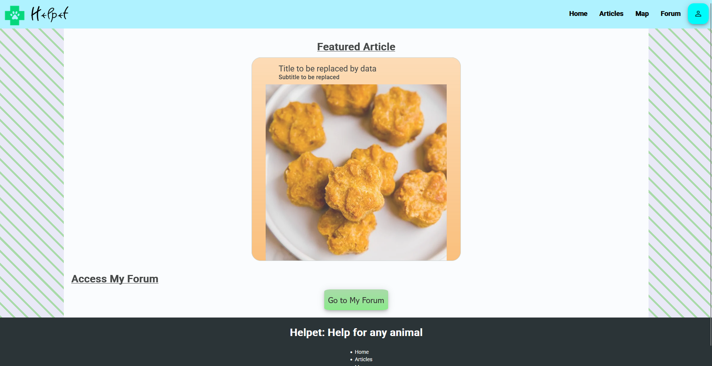
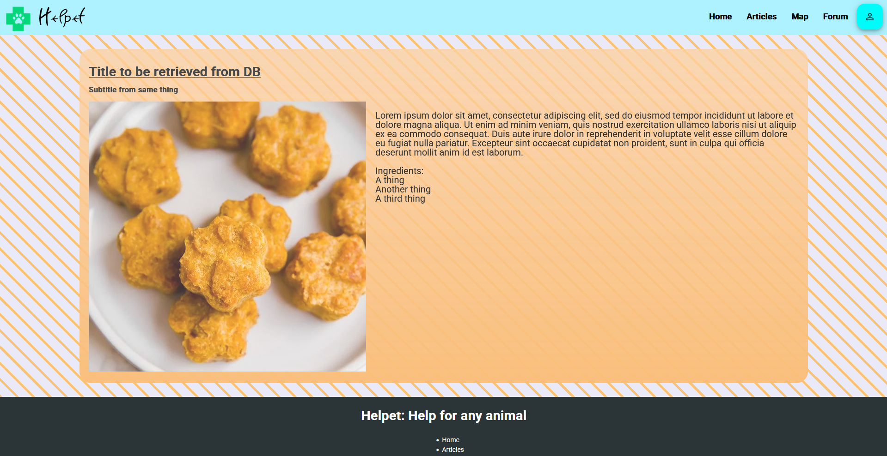

# Helpet (Web)
The Web version of Helpet, a website designed to help owners with getting information for their little critters without having to do multiple searches to make sure that the information you get is safe.
This webpage is still on a prototyped version, as the connection to the database and other things haven't been added yet.

## How To Install
In order to install this project, make sure to open a Git Terminal (Or your terminal of choice) on a folder, and type in
```
git clone https://github.com/rin-5/Helpet_Web.git
```
Once the project is installed to your folder, navigate to frontend/Helpet and run the following commands:
```
npm install
```
```
ng serve
```
And, the website will open at [http:/localhost:4200](http:/localhost:4200). There, you can navigate through the website via the footer or the header.



## This project was made with...

